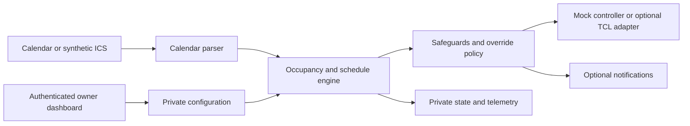

# Architecture

## Control flow

`src/calendar_parser.py` classifies common iCalendar exports, caches successful downloads, and reports staleness and missing reservations. `src/scheduler.py` maps occupancy and local time into room targets. `src/safeguards.py` adds cycle throttling, cancellation grace periods, guest preference handling, and protection against inappropriate shutdowns. `src/orchestrator.py` coordinates a complete cycle.

`src/base_controller.py` defines the device interface. `MockACController` simulates independent devices. `src/tcl/` contains an optional unofficial TCL Cloud client and controller. Account authentication and cloud discovery obtain temporary service credentials; no AWS keys are shipped. Provider URLs and shared application protocol identifiers are protocol constants, not a private account configuration.

`src/state_store.py`, `src/dashboard/config_store.py`, and `src/monitoring/` support private local or optional cloud persistence. `src/notifier.py` supports console/audit events and optional Telegram/webhook delivery. `src/dashboard/` handles authentication, CSRF checks, configuration, and owner controls. `lambda_handler.py` provides separate automation and dashboard entrypoints.

## Trust boundaries

Calendar text and network responses are untrusted input. A calendar URL is a bearer secret even when its path contains the token. The public edition masks the whole URL in calendar diagnostics and omits raw fetch exception text. TCL HTTP failures omit response bodies and raw transport errors. Those protections do not make application logs or state safe to publish.

The dashboard requires an independently generated signing secret of at least 32 characters and a PBKDF2-SHA256 password hash. There is no built-in signing key, password-derived key, or plaintext login fallback. Login rate limiting uses the gateway's source address rather than an arbitrary forwarded header. A deployment must ensure the gateway metadata itself is trusted. Local rate limiting is for one process; a distributed deployment needs a shared backend. Embedded dashboard JSON escapes HTML-sensitive characters, and telemetry strings use DOM text insertion.

External HTTP adapters require HTTPS and reject URL user information, HTTP downgrades, and cross-origin redirects. This may require configuring a provider's final HTTPS calendar URL directly. The unofficial TCL protocol still uses legacy MD5 wire digests; changing that protocol unilaterally would break compatibility. These digests are not used for dashboard password storage.

The demo and tests are an offline trust boundary: they clear inherited integration settings before importing the application and reject network and subprocess audit events. Optional adapters outside that boundary can contact cloud services whenever configured. Read-only TCL mode still authenticates and fetches data; dry-run does not disable notifications or cloud persistence.

## State and physical safety

Reservation records, calendar cache, room telemetry, user overrides, and audit events can reveal guest occupancy. Treat every generated file as private; avoid personal names in feeds and use short retention periods. S3 and dashboard deployment, IAM, TLS, rate limiting, log retention, backup, and alert delivery are the operator's responsibility. No production resource name, account number, endpoint, or deployment state is supplied.

The schedule uses `Europe/Sofia`; adapting to a different property requires a deliberate timezone review. Cancellation and stale-calendar behavior must be evaluated against the building's frost and comfort needs. Simulation tests cannot confirm physical heating, firmware behavior, API availability, or notification delivery.
